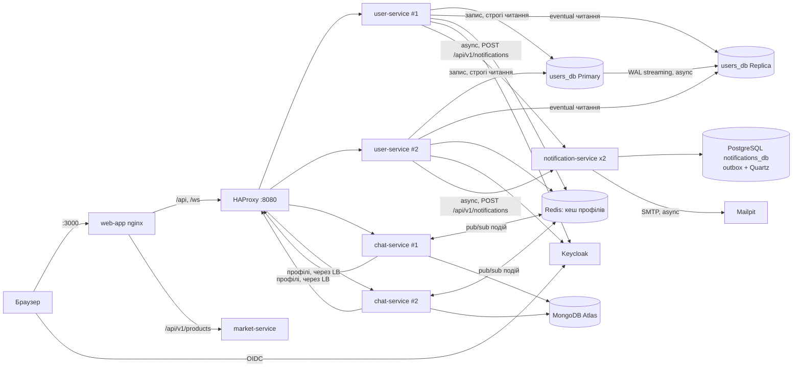

# Bricklayers

Платформа для будівельних бригад: керування користувачами (Keycloak + `user-service`), робочий чат
(`chat-service`, WebSocket/STOMP), e-mail сповіщення (`notification-service`), маркетплейс матеріалів
(`market-service`) і веб-клієнт (`web-app`, React).

**Стек:** Java 21, Spring Boot 4.1, PostgreSQL 16, MongoDB Atlas, Redis 7.4, Keycloak 25, HAProxy 3.0, Quartz 2.5,
Mailpit, React 19 + Vite, k6, Testcontainers, Docker Compose.

## Швидкий запуск

Потрібні Docker Desktop (Linux containers) і Compose v2. У `src/.env` має бути `MONGO_URI` (MongoDB Atlas),
решта значень — див. [`src/.env.example`](src/.env.example).

```powershell
cd src
docker compose up -d --build --wait
```

| Адреса | Що це |
|---|---|
| http://localhost:3000 | Веб-клієнт: вхід через Keycloak → чат (SUPERADMIN → керування користувачами) |
| http://localhost:8080 | HAProxy — єдина точка входу до `user-service` і `chat-service` |
| http://localhost:8080/user-service/swagger-ui.html | Swagger `user-service` (через балансувальник, **Authorize** → Keycloak) |
| http://localhost:8080/chat-service/swagger-ui.html | Swagger `chat-service` |
| http://localhost:8085 | Swagger для OIDC / Admin API Keycloak |
| http://localhost:8025 | Mailpit: листи, які надсилає `notification-service` (Lab 5) |
| `localhost:5435` | PostgreSQL `notifications_db`: outbox листів і таблиці Quartz |
| `localhost:5433` / `localhost:5436` | PostgreSQL `users_db`: Primary / Replica (hot standby, лише читання) |
| http://localhost:8404 | Статистика HAProxy: стан кожної репліки (тільки з localhost) |
| http://localhost:8084 | Keycloak (`admin` / `admin`) |
| `localhost:6379` | Redis (кеш профілів, події чату) — IDE / `redis-cli` |
| `docker compose ps user-service chat-service notification-service` | Прямі порти кожної репліки (Docker призначає вільні, змінюються при перестворенні) |

Прямий доступ до реплік і Redis відкриває [`src/docker-compose.override.yml`](src/docker-compose.override.yml) —
Compose підхоплює його автоматично. Щоб показати інкапсуляцію з Lab 3 (клієнт бачить лише балансувальник),
запустіть без нього: `docker compose -f docker-compose.yml up -d`.

Тестові користувачі realm `bricklayers` (одна компанія): `foreman/foreman` (прораб), `worker/worker`
(будівельник), `supplier/supplier` (постачальник), `superadmin/superadmin`. Профілі потрапляють у
`user-service` через синхронізацію з Keycloak приблизно через 10 с після старту.

> Realm імпортується лише при створенні контейнера Keycloak. Після змін у
> [`bricklayers-realm.json`](src/keycloak/bricklayers-realm.json) перестворіть його:
> `docker compose up -d --force-recreate keycloak`. Новий Keycloak видає користувачам нові id; якщо в
> `users_db` лишились старі профілі, синхронізація пропустить їх як конфлікт — тоді очистіть том
> `users_db_data` (`docker compose down` + `docker volume rm users_db_data`).

## Архітектура



## Лабораторні роботи з високонавантажених систем

| Лаба | Що зроблено | Звіт |
|---|---|---|
| 2. Stateless | Аудит стану; WebSocket-події через Redis pub/sub; ShedLock для планувальника; `STATELESS`; `X-Instance-ID`; репліки з одного образу | [docs/lab2-stateless.md](docs/lab2-stateless.md) |
| 3. Horizontal Scaling | HAProxy з DNS-виявленням реплік, `GET /health`, активні health checks, round robin / least connections / IP hash, k6-експерименти | [docs/lab3-horizontal-scaling.md](docs/lab3-horizontal-scaling.md) |
| 4. Distributed Caching | Cache-Aside профілів у Redis, `X-Cache`, інвалідація після commit, TTL з jitter, fallback і circuit breaker | [docs/lab4-distributed-caching.md](docs/lab4-distributed-caching.md) |
| 5. Load & Performance Baseline | k6-сценарії A/B/C зі ступенями 10→200 VU і розігрівом, специфікація середовища, `docker stats`, точка насичення й вузькі місця, 1 vs N інстансів, кеш вимк./увімк. | [docs/lab5-load-baseline.md](docs/lab5-load-baseline.md) |
| 6. Database Replication | Primary + hot-standby Replica `users_db`, `ReadWriteRoutingDataSource`, класифікація читань, sticky read-your-writes, fallback і read-only режим, порівняння 1 вузол / +1 / +2 репліки | [docs/lab6-replication.md](docs/lab6-replication.md) |
| Async (`@Async`) | Окремий `notification-service`; обмежені `ThreadPoolTaskExecutor` в обох сервісах; листи fire-and-forget (передача після commit + outbox); огляд акаунта з двох `@Async` + `thenCombine`; тайм-аути, `AsyncUncaughtExceptionHandler`, 503 при переповненні | [docs/lab5-async.md](docs/lab5-async.md) |
| Quartz Scheduler | `notification-service`: JDBC job store у кластері, схема `QRTZ_*` через Liquibase; 2 завдання (повтор / очищення листів) / 3 тригери, JobDataMap з пріоритетом тригера, misfire, часовий пояс, ідемпотентність, обмежені повтори | [docs/lab6-quartz.md](docs/lab6-quartz.md) |

Демонстраційні скрипти (PowerShell 5.1 / 7, запуск із `src`):

```powershell
.\scripts\demo-stateless.ps1 -SimulateFailure     # Lab 2
docker compose run --rm --no-deps --entrypoint k6 load run /scripts/chat-relay.js   # Lab 2, чат
.\scripts\run-lab3.ps1 -Scenario all              # Lab 3
.\scripts\demo-cache.ps1 -SimulateFailure         # Lab 4
.\scripts\demo-async.ps1 -SimulateMailOutage       # Async (+ Quartz-повтор листа)
.\scripts\demo-quartz.ps1 -ChangeDefinition        # Quartz
.\scripts\run-load-baseline.ps1 -Experiment all     # Lab 5 (+ порівняння топологій Lab 6), ~1 год
.\scripts\demo-replication.ps1                     # Lab 6: реплікація, stale read, sticky, відмови вузлів
```

## Структура

```
src/
  docker-compose.yml     усі сервіси, репліки, HAProxy, Redis, k6 (profile tools)
  infra/haproxy.cfg      балансувальник
  keycloak/              realm, тема логіну, OpenAPI Keycloak
  load-tests/            k6: scaling.js (Lab 3), chat-relay.js (Lab 2)
  scripts/               демонстраційні скрипти лаб
  web-api/
    common/              спільні DTO (UserInfo, NotificationRequest), X-Instance-ID, lab3-фільтр затримки
    user-service/        користувачі, адмінка, аудит, синхронізація з Keycloak, кеш профілів,
                         огляд акаунта (@Async), передача листів у notification-service
    chat-service/        чати, повідомлення, WebSocket, Redis-ретрансляція подій
    notification-service/ e-mail: outbox, async SMTP, Quartz (повтор і очищення)
    market-service/      каталог матеріалів
  web-app/               React-клієнт
docs/                    звіти лабораторних
```

## Тести

Покриття кожного модуля (крім `market-service`) перевіряє JaCoCo на фазі `verify`: збірка падає, якщо покриття
рядків або інструкцій нижче 60 % (`jacoco.minimum.coverage` у [src/web-api/pom.xml](src/web-api/pom.xml)).
Звіт: `<модуль>/target/site/jacoco/index.html`.

```powershell
cd src\web-api
mvn test -pl common,user-service,chat-service,notification-service -am
mvn verify -pl common,user-service,chat-service,notification-service -am   # + *IT (Testcontainers, потрібен Docker) і JaCoCo check
cd ..\web-app
npm run lint; npm run build
```
