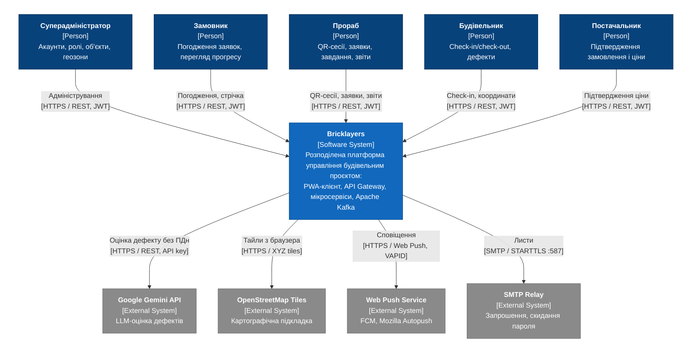
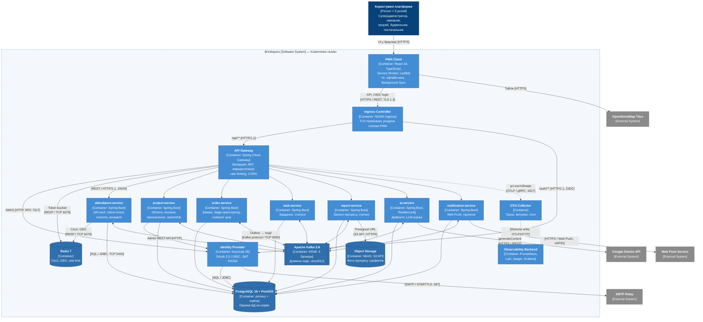
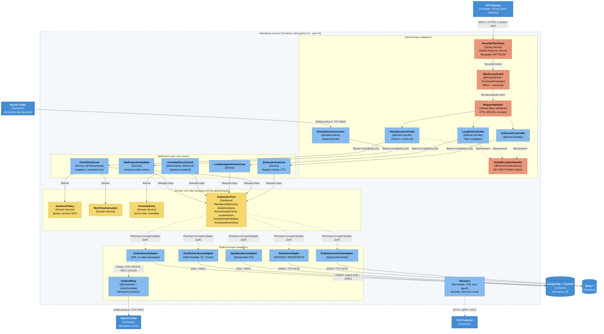

# Розділ 2. Проєктування

Розділ формалізує архітектуру системи Bricklayers на основі контракту вимог [srs.md](./srs.md). Архітектура описана за методологією C4 Model (рівні Context, Container, Component) у форматі Diagrams-as-Code (Mermaid.js), архітектурні компроміси зафіксовано в реєстрі [ADR](./adr/README.md).

**Нотація.** Діаграми побудовано засобами Mermaid `flowchart` з кольоровою нотацією C4: темно-синій — [Person], синій — [Software System] / [Container], блакитний — [Component], жовтий — доменне ядро, помаранчевий — компоненти захисту, сірий — [External System]. Кожен зв'язок підписано технологією або протоколом у квадратних дужках. Експериментальний синтаксис `C4Context`/`C4Container` у Mermaid не застосовано, оскільки він не має автоматичного розміщення елементів і накладає підписи зв'язків (див. AI Insights до ЛР№5).

## 2.1. Контекстне та контейнерне моделювання системи (C4 Model)

### 2.1.1. System Context Diagram (C4 Level 1)

**Актори.** Суперадміністратор, замовник, прораб, будівельник і постачальник взаємодіють із системою через PWA-клієнт за протоколом HTTPS / REST з access-токеном JWT ([SRS-FUN-01](./srs.md#srs-fun-01), [SRS-FUN-02](./srs.md#srs-fun-02)). Повноваження ролей наведено в [SRS, розділ 2.2](./srs.md#22-користувачі).

**Зовнішні системи.**

| Система | Протокол | Призначення | Вимоги |
| --- | --- | --- | --- |
| Google Gemini API | HTTPS / REST, API key | Консультативна оцінка знеособленого опису дефекту | [SRS-FUN-24](./srs.md#srs-fun-24) – [SRS-FUN-26](./srs.md#srs-fun-26), [SRS-NFR-REL-06](./srs.md#srs-nfr-rel-06) |
| OpenStreetMap Tiles | HTTPS / XYZ tiles | Картографічна підкладка; запити надходять безпосередньо з браузера | [SRS-FUN-12](./srs.md#srs-fun-12), [SRS-CON-03](./srs.md#srs-con-03) |
| Web Push Service | HTTPS / Web Push (RFC 8030), VAPID (RFC 8292) | Доставка push-сповіщень у браузер | [SRS-FUN-29](./srs.md#srs-fun-29) |
| SMTP Relay | SMTP / STARTTLS, порт 587 | Листи-запрошення та скидання пароля від Identity Provider | [SRS-FUN-01](./srs.md#srs-fun-01) |

### 2.1.2. Container Diagram (C4 Level 2)

**Контейнери.**

| Контейнер | Технологія | Відповідальність | Вимоги / рішення |
| --- | --- | --- | --- |
| PWA Client | React 18, TypeScript, Service Worker, Leaflet | UI, кешування app shell, офлайн-буфер (Background Sync), Web Geolocation API | [SRS-FUN-30](./srs.md#srs-fun-30), [SRS-NFR-PERF-07](./srs.md#srs-nfr-perf-07) |
| Ingress Controller | NGINX Ingress | TLS-термінація, HSTS, роздача статичних ресурсів PWA, маршрутизація `/api/**` і `/auth/**` | [SRS-NFR-SEC-02](./srs.md#srs-nfr-sec-02) |
| API Gateway | Spring Cloud Gateway | Валідація JWT за JWKS, грубозерниста RBAC-перевірка, rate limiting (Redis token bucket), CORS, проброс `traceparent` | [SRS-FUN-02](./srs.md#srs-fun-02), [SRS-NFR-SEC-03](./srs.md#srs-nfr-sec-03) |
| Identity Provider | Keycloak 26 | OAuth 2.0 / OIDC, видача JWT RS256, ролі, ротація refresh-токенів, Argon2id | [SRS-FUN-01](./srs.md#srs-fun-01), [SRS-NFR-SEC-01](./srs.md#srs-nfr-sec-01) |
| project-service | Spring Boot 3.4, Java 21 | Об'єкти, геозони, призначення користувачів, перевірка ownership, блокування акаунтів через Keycloak Admin REST API, audit trail | [SRS-FUN-03](./srs.md#srs-fun-03) – [SRS-FUN-05](./srs.md#srs-fun-05) |
| attendance-service | Spring Boot 3.4, Java 21 | QR-сесії, check-in/check-out, геопотік, детекція аномалій | [SRS-FUN-06](./srs.md#srs-fun-06) – [SRS-FUN-14](./srs.md#srs-fun-14); [C4 Level 3](#diagram-level3) |
| order-service | Spring Boot 3.4, Java 21 | Заявки, Saga-оркестратор як внутрішній компонент, снапшот ціни, компенсуючі транзакції | [SRS-FUN-15](./srs.md#srs-fun-15) – [SRS-FUN-21](./srs.md#srs-fun-21) |
| task-service | Spring Boot 3.4, Java 21 | Завдання, призначення, підтвердження закриття | [SRS-FUN-22](./srs.md#srs-fun-22), [SRS-FUN-23](./srs.md#srs-fun-23) |
| report-service | Spring Boot 3.4, Java 21 | Записи прогресу, хронологічна стрічка, факт перегляду, presigned URL для фото | [SRS-FUN-27](./srs.md#srs-fun-27), [SRS-FUN-28](./srs.md#srs-fun-28) |
| ai-service | Spring Boot 3.4, Resilience4j | Звіти про дефекти, знеособлення тексту, виклик Gemini API, історія рекомендацій | [SRS-FUN-24](./srs.md#srs-fun-24) – [SRS-FUN-26](./srs.md#srs-fun-26) |
| notification-service | Spring Boot 3.4 | Споживання доменних подій, підписки Web Push, надсилання сповіщень | [SRS-FUN-29](./srs.md#srs-fun-29), [SRS-NFR-PERF-06](./srs.md#srs-nfr-perf-06) |
| Apache Kafka | Kafka 3.8, KRaft, 3 брокери | Доменні події, retry- і DLQ-топіки | [SRS-NFR-REL-03](./srs.md#srs-nfr-rel-03), [SRS-NFR-REL-04](./srs.md#srs-nfr-rel-04); [ADR-001](./adr/0001-choice-of-technology.md) |
| PostgreSQL + PostGIS | PostgreSQL 16, PostGIS 3.4, primary + streaming replica | Окрема логічна БД на кожен сервіс і Keycloak; геопросторові запити | [SRS-FUN-07](./srs.md#srs-fun-07), [SRS-NFR-REL-02](./srs.md#srs-nfr-rel-02) |
| Redis | Redis 7 | Кеш активних сесій, GEO-позиції, rate-limit buckets | [SRS-FUN-11](./srs.md#srs-fun-11), [SRS-NFR-PERF-05](./srs.md#srs-nfr-perf-05) |
| Object Storage | MinIO (S3 API) | Зображення записів прогресу та дефектів | [SRS-FUN-27](./srs.md#srs-fun-27) |
| OTel Collector | OpenTelemetry Collector | Прийом трас, метрик і логів від усіх контейнерів | [SRS-NFR-OBS-01](./srs.md#srs-nfr-obs-01) – [SRS-NFR-OBS-03](./srs.md#srs-nfr-obs-03) |
| Observability Backend | Prometheus, Loki, Jaeger, Grafana | Зберігання телеметрії, дашборди, алерти | [SRS-NFR-OBS-04](./srs.md#srs-nfr-obs-04) |

**Зв'язки та протоколи.**

| Від → До | Протокол | Призначення |
| --- | --- | --- |
| PWA → Ingress | HTTPS / REST, TLS 1.3 | API-виклики та OIDC-логін (Authorization Code + PKCE) |
| PWA → OpenStreetMap Tiles | HTTPS | Завантаження тайлів карти |
| Ingress → API Gateway | HTTP/1.1 | Маршрут `/api/**` усередині кластера |
| Ingress → Identity Provider | HTTP/1.1, OIDC | Маршрут `/auth/**` |
| API Gateway → Identity Provider | HTTP, JWKS (RFC 7517) | Отримання та кешування публічних ключів підпису JWT |
| API Gateway → Redis | RESP / TCP 6379 | Лічильники token bucket для rate limiting |
| API Gateway → доменні сервіси | REST / HTTP/1.1, JSON | Проксування запитів із заголовками `Authorization` і `traceparent` |
| project-service → Identity Provider | HTTP / REST (Keycloak Admin API) | Блокування користувача, завершення сесій |
| attendance-service → Redis | RESP / TCP 6379 | Кеш активних сесій, `GEOADD`/`GEOSEARCH` |
| Доменні сервіси, Keycloak → PostgreSQL | SQL / JDBC, TCP 5432 | Транзакційні дані; таблиці outbox та оброблених подій |
| Доменні сервіси ↔ Apache Kafka | Kafka protocol / TCP 9092 | Публікація подій з outbox, споживання подій інших сервісів |
| report-service → Object Storage | S3 API / HTTPS | Генерація presigned URL; PWA завантажує файли напряму |
| ai-service → Google Gemini API | HTTPS / REST | Виклик `generateContent` під Circuit Breaker, Retry, Bulkhead |
| notification-service → Web Push Service | HTTPS / Web Push, VAPID | Надсилання зашифрованих push-повідомлень |
| Identity Provider → SMTP Relay | SMTP / STARTTLS, 587 | Листи-запрошення та скидання пароля |
| Усі контейнери → OTel Collector | OTLP / gRPC, 4317 | Траси, метрики, логи |
| OTel Collector → Observability Backend | Prometheus remote write, OTLP / HTTP | Експорт телеметрії |

Синхронні виклики між доменними сервісами відсутні: дані інших доменів (геозони, призначення, блокування користувачів) надходять через події Apache Kafka та зберігаються в локальних проєкціях, що відповідає вибору брокера в [ADR-001](./adr/0001-choice-of-technology.md). Мережеві зв'язки, не наведені в таблиці, забороняються політиками NetworkPolicy ([SRS-NFR-SEC-08](./srs.md#srs-nfr-sec-08)).

## 2.2. Компонентне моделювання критичного сервісу системи

### 2.2.1. Обґрунтування вибору сервісу

Для декомпозиції обрано **attendance-service**, оскільки він:

- несе найвище навантаження системи: піковий check-in ([SRS-NFR-PERF-03](./srs.md#srs-nfr-perf-03)) та безперервний потік геокоординат ≥ 100 запитів/с ([SRS-NFR-PERF-04](./srs.md#srs-nfr-perf-04));
- містить ключові інваріанти домену: геопросторова верифікація ([SRS-FUN-07](./srs.md#srs-fun-07)) та єдина активна сесія ([SRS-FUN-08](./srs.md#srs-fun-08));
- обробляє персональні геодані з вимогами комплаєнсу ([SRS-NFR-PRIV-01](./srs.md#srs-nfr-priv-01) – [SRS-NFR-PRIV-05](./srs.md#srs-nfr-priv-05));
- одночасно використовує PostgreSQL/PostGIS, Redis та Apache Kafka.

### 2.2.2. Діаграма компонентів attendance-service (C4 Level 3)

### 2.2.3. Опис компонентів

Сервіс побудовано за принципами Clean Architecture (Ports and Adapters): залежності спрямовані до доменного ядра, доменне ядро не залежить від Spring, JPA, Redis чи Kafka. Зв'язування реалізацій з інтерфейсами виконує Spring IoC-контейнер (Dependency Injection через конструктор).

**Вхідний шар (Inbound adapters)**

| Компонент | Технологія | Роль | Взаємодія |
| --- | --- | --- | --- |
| SecurityFilterChain | Spring Security OAuth2 Resource Server | Повторна валідація підпису та строку дії JWT за JWKS (zero trust після API Gateway) | Servlet Filter, формує `SecurityContext` |
| SiteAccessGuard | `@PreAuthorize`, `PermissionEvaluator` | Перевірка ролі та належності користувача до об'єкта за локальною проєкцією призначень ([SRS-FUN-02](./srs.md#srs-fun-02), [SRS-FUN-03](./srs.md#srs-fun-03)) | Spring AOP-проксі перед методом контролера |
| RequestValidator | Jakarta Bean Validation | Валідація DTO: діапазони WGS 84, точність ≤ 50 м, розмір пакета координат ≤ 10 точок | `@Valid` на параметрах контролера |
| QrSessionController | `@RestController` | `POST /sites/{id}/qr-sessions` ([SRS-FUN-06](./srs.md#srs-fun-06)) | Викликає `QrSessionUseCase` через інтерфейс |
| AttendanceController | `@RestController` | `POST /attendance/check-in`, `POST /attendance/check-out` ([SRS-FUN-07](./srs.md#srs-fun-07) – [SRS-FUN-09](./srs.md#srs-fun-09)) | Викликає `CheckInUseCase` через інтерфейс |
| LocationController | `@RestController` | `POST /attendance/{sessionId}/locations` — пакет координат ([SRS-FUN-11](./srs.md#srs-fun-11)) | Викликає `LocationIngestionUseCase` |
| DomainEventConsumer | `@KafkaListener` | Споживання `SiteGeofenceUpdated`, `UserAssigned`, `UserBlocked`; дедуплікація за `eventId` ([SRS-NFR-REL-05](./srs.md#srs-nfr-rel-05)) | Викликає `SiteProjectionUpdater` |
| GlobalExceptionHandler | `@RestControllerAdvice` | Перетворення доменних виключень на RFC 9457 Problem Details (400, 403, 409, 422), без витоку стек-трейсів | Spring MVC exception resolution |

**Прикладний шар (Use cases)**

| Компонент | Роль |
| --- | --- |
| QrSessionUseCase | Видача підписаного токена QR-сесії з TTL 5–60 хв. |
| CheckInUseCase | Транзакційний сценарій check-in/check-out: перевірка токена, виклик `GeofencePolicy`, створення сесії, запис події в outbox в одній транзакції. |
| LocationIngestionUseCase | Запис поточної позиції в Redis GEO та сирих координат у PostgreSQL зі строком зберігання 90 діб ([SRS-NFR-PRIV-02](./srs.md#srs-nfr-priv-02)). |
| AnomalyDetectionJob | Періодичне (60 с) застосування `AnomalyRules` до активних сесій; ShedLock гарантує виконання на одній репліці; результат — подія `AnomalyDetected` ([SRS-FUN-13](./srs.md#srs-fun-13)). |
| SiteProjectionUpdater | Оновлення локальної копії геозон, призначень і блокувань; при `UserBlocked` закриває активну сесію ([SRS-FUN-04](./srs.md#srs-fun-04)). |

**Доменне ядро**

| Компонент | Роль |
| --- | --- |
| GeofencePolicy | Правило належності точки геозоні з урахуванням точності GPS; делегує геометричну перевірку порту `GeofenceQuery`. |
| WorkTimeCalculator | Обчислення тривалості сесії та автозакриття через 12 год ([SRS-FUN-10](./srs.md#srs-fun-10)). |
| AnomalyRules | Правила «вихід за геозону» та «нерухомість понад поріг» з порогами об'єкта. |
| Outbound Ports | Інтерфейси `AttendanceRepository`, `GeofenceQuery`, `ActiveSessionCache`, `LocationStore`, `DomainEventPublisher`, `ProcessedEventStore`, визначені в ядрі (Dependency Inversion Principle). |

**Вихідний шар (Outbound adapters)**

| Компонент | Технологія | Роль |
| --- | --- | --- |
| JpaAttendanceAdapter | Spring Data JPA | Реалізація `AttendanceRepository`; частковий унікальний індекс `UNIQUE (user_id) WHERE status = 'ACTIVE'` забезпечує [SRS-FUN-08](./srs.md#srs-fun-08). |
| PostGisGeofenceAdapter | JdbcTemplate, PostGIS | Реалізація `GeofenceQuery` через `ST_Covers(geofence, ST_Buffer(point::geography, accuracy))`. |
| RedisSessionCacheAdapter | Spring Data Redis | Реалізація `ActiveSessionCache` (TTL = залишок сесії), [SRS-NFR-PERF-05](./srs.md#srs-nfr-perf-05). |
| RedisGeoAdapter | Redis `GEOADD`/`GEOSEARCH` | Реалізація `LocationStore` для поточних позицій ([SRS-FUN-12](./srs.md#srs-fun-12)). |
| OutboxEventAdapter | JPA | Реалізація `DomainEventPublisher`: запис події в таблицю `outbox` у транзакції use case. |
| OutboxRelay | `@Scheduled`, KafkaTemplate | Вибірка записів outbox (`FOR UPDATE SKIP LOCKED`), публікація в `attendance.events` ідемпотентним producer з `acks=all` ([ADR-001](./adr/0001-choice-of-technology.md)). |
| Telemetry | Micrometer, OpenTelemetry Java agent | RED-метрики, `trace_id` у логах, експорт OTLP ([SRS-NFR-OBS-01](./srs.md#srs-nfr-obs-01) – [SRS-NFR-OBS-03](./srs.md#srs-nfr-obs-03)). |

### 2.2.4. Проходження запиту check-in крізь компоненти

1. API Gateway проксує `POST /attendance/check-in` з JWT; `SecurityFilterChain` валідує токен.
2. `SiteAccessGuard` перевіряє роль «Будівельник» і призначення на об'єкт; `RequestValidator` валідує координати й точність.
3. `AttendanceController` викликає `CheckInUseCase` через інтерфейс.
4. `CheckInUseCase` у межах однієї транзакції PostgreSQL: перевіряє токен QR-сесії, викликає `GeofencePolicy` (→ `GeofenceQuery` → PostGIS), створює запис сесії (→ `AttendanceRepository`) і записує подію `CheckedIn` (→ `DomainEventPublisher` → таблиця outbox).
5. Порушення унікального індексу перетворюється на `ActiveSessionExistsException`, яке `GlobalExceptionHandler` повертає як HTTP 409.
6. Після commit сесія кешується в Redis; `OutboxRelay` публікує подію в Apache Kafka, звідки її споживає notification-service.

## 2.3. Документування архітектурних рішень (Architecture Decision Records)

| ID | Рішення | Статус | Дата |
| --- | --- | --- | --- |
| [ADR-001](./adr/0001-choice-of-technology.md) | Вибір брокера повідомлень для доменних подій: Apache Kafka | Approved | 10.11.2026 |

Повний реєстр рішень: [adr/README.md](./adr/README.md).
