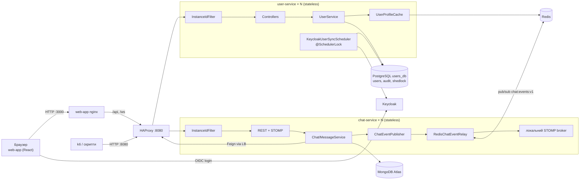

# Лабораторна №2 — Stateless-архітектура та винесення стану

**Обсяг:** `user-service` (Spring Boot + PostgreSQL) і `chat-service` (Spring Boot + MongoDB + WebSocket/STOMP).
`market-service` у цій роботі не змінювався.

Кожен сервіс запускається щонайменше у двох репліках з одного образу. Будь-яка репліка може обробити будь-який
запит: бізнес-стан лежить у PostgreSQL / MongoDB, координація — у PostgreSQL (ShedLock) і Redis (pub/sub).

## Запуск

```powershell
cd src
docker compose up -d --build --wait
docker compose ps        # user-service-1/2, chat-service-1/2, lb, redis, ...
```

Репліки не публікують портів — до них можна дістатися лише через HAProxy на `http://localhost:8080`
(див. [Lab 3](lab3-horizontal-scaling.md)). Кількість реплік: `USER_SERVICE_REPLICAS`, `CHAT_SERVICE_REPLICAS`.

## 2.1 Аудит стану

| Категорія | Де в коді | Висновок |
|---|---|---|
| **Shared / Externalized** | `users`, `admin_audit_log` (PostgreSQL), усі `*Repository` user-service | Бізнес-стан користувачів і аудит — у спільній БД |
| **Shared / Externalized** | `chats`, `chat_buckets` (MongoDB Atlas), `ChatRepository`, `ChatBucketRepository` | Чати, повідомлення, лайки, статуси прочитання — у спільній БД |
| **Shared / Externalized** | Ідентичність користувача | JWT від Keycloak у кожному запиті / STOMP `CONNECT`; сервер не пам'ятає логін між запитами |
| **Shared / Externalized** | `shedlock` (PostgreSQL) | Блокування планувальника, спільне для всіх реплік |
| **Shared / Externalized** | Redis `chat:events:v1`, `user:profile:v1:*` | Шина подій чату та кеш профілів ([Lab 4](lab4-distributed-caching.md)); не є джерелом істини |
| **Ephemeral / Local Safe** | Локальні змінні сервісів, DTO, `Page`, результати запитів | Існують лише в межах одного виклику |
| **Ephemeral / Local Safe** | `static final Set<ChatType> DIRECT_TYPES`, `KEYCLOAK_ROLES`, `ParameterizedTypeReference` | Незмінні константи |
| **Ephemeral / Local Safe** | HikariCP / Mongo / Lettuce пули, Spring-контекст | Інфраструктура процесу, відтворюється при старті |
| **Ephemeral / Local Safe** | `InstanceId`, логи, `/tmp` | Діагностика; мітка не використовується для маршрутизації чи пошуку даних |
| **Ephemeral / Local Safe** | Відкрите WebSocket-з'єднання | Фізично належить одній репліці. Після її падіння клієнт перепідключається (`reconnectDelay: 3000`) до будь-якої іншої; історія підвантажується з MongoDB |
| **Critical → усунено** | `enableSimpleBroker("/topic")` у [ChatWebSocketConfig.java](../src/web-api/chat-service/src/main/java/com/bricklayers/chatservice/config/ChatWebSocketConfig.java) | In-memory брокер: подія, опублікована на репліці A, не доходила до клієнтів, підключених до B. Тепер подія йде через Redis pub/sub на всі репліки |
| **Critical → усунено** | `@Scheduled KeycloakUserSyncScheduler` | Кожна репліка запускала синхронізацію одночасно (подвійні звернення до Keycloak, гонки запису). Тепер `@SchedulerLock` + таблиця `shedlock` |
| **Critical → усунено** | Spring Security без явної політики сесій | Могла створюватися `HttpSession` (`JSESSIONID`) → прихована прив'язка до репліки. Тепер `SessionCreationPolicy.STATELESS` в обох сервісах |
| **Critical → не знайдено** | `HttpSession`, `@SessionAttributes`, файлові сесії, `synchronized`/JVM-локи, бізнес-лічильники, локальні кеші | Пошук по коду не виявив |

### Перелік змін

| Було | Стало | Файл |
|---|---|---|
| `SimpMessagingTemplate.convertAndSend` напряму в локальний брокер | `ChatEventRelay`: публікація в Redis-канал `chat:events:v1`, кожна репліка ретранслює своїм WebSocket-клієнтам | [RedisChatEventRelay.java](../src/web-api/chat-service/src/main/java/com/bricklayers/chatservice/service/relay/RedisChatEventRelay.java), [RedisEventRelayConfig.java](../src/web-api/chat-service/src/main/java/com/bricklayers/chatservice/config/RedisEventRelayConfig.java) |
| Синхронізація з Keycloak на кожній репліці | Одна репліка за період (`lockAtLeastFor=30s`), блокування за часом БД | [SchedulerLockConfig.java](../src/web-api/user-service/src/main/java/com/bricklayers/userservice/config/SchedulerLockConfig.java), [05-create-shedlock-table.yaml](../src/web-api/user-service/src/main/resources/db/changelog/changes/05-create-shedlock-table.yaml) |
| Сесійна політика за замовчуванням, `logout` з видаленням `JSESSIONID` | `STATELESS`, без logout-обробника (виходом керує Keycloak) | `SecurityConfig.java` обох сервісів |
| Фіксовані `container_name` і `ports` | `deploy.replicas`, без портів назовні | [docker-compose.yml](../src/docker-compose.yml) |
| — | `X-Instance-ID` у кожній відповіді | [InstanceIdFilter.java](../src/web-api/common/src/main/java/com/bricklayers/common/instance/InstanceIdFilter.java) |

Якщо Redis недоступний, `RedisChatEventRelay` доставляє подію локальним підписникам (деградація: живе оновлення
бачать лише клієнти тієї ж репліки, повідомлення при цьому вже збережене в MongoDB). Підписка на канал
стартує у фоні з повторними спробами, тож chat-service запускається і без Redis.

## 2.3 Stateless Request Flow

Сценарій — зміна профілю користувача адміністратором `PUT /api/v1/admin/users/{id}`:

```mermaid
sequenceDiagram
    participant C as Клієнт (JWT)
    participant LB as HAProxy
    participant U1 as user-service #1
    participant U2 as user-service #2
    participant KC as Keycloak
    participant DB as PostgreSQL
    participant R as Redis
    C->>LB: PUT /api/v1/admin/users/{id} + Bearer JWT
    LB->>U1: round robin
    U1->>U1: перевірка підпису JWT (JWKS), ролі SUPERADMIN
    U1->>DB: BEGIN; SELECT user; UPDATE users
    U1->>KC: оновити користувача в Keycloak
    U1->>DB: COMMIT (+ запис admin_audit_log)
    U1->>R: afterCommit: DEL user:profile:v1:id:{id}, ...:kc:{keycloakId}
    U1-->>C: 200 + X-Instance-ID: #1
    C->>LB: GET /api/v1/admin/users/{id}
    LB->>U2: round robin
    U2->>R: GET user:profile:v1:id:{id} → немає (MISS)
    U2->>DB: SELECT user
    U2->>R: SET ... EX 300±10%
    U2-->>C: 200 актуальні дані + X-Instance-ID: #2, X-Cache: MISS
```

- **Вхідні параметри:** `id` у шляху, тіло запиту, JWT у `Authorization`. Більше нічого сервер не бере з попередніх запитів.
- **Читання контексту:** користувач — з PostgreSQL; ролі — з JWT; ключі для перевірки підпису — з Keycloak JWKS.
- **Атомарна зміна:** одна транзакція PostgreSQL; інвалідація кешу — лише після commit.
- **Після запиту** в пам'яті репліки не лишається нічого, що вплинуло б на наступний запит.

Чат-повідомлення: `POST /api/v1/chats/{id}/messages` → запис у MongoDB → `ChatEventPublisher` →
Redis `PUBLISH chat:events:v1` → **кожна** репліка (включно з автором) отримує подію і надсилає її у
`/topic/chats/{id}` своїм WebSocket-підписникам.

## 2.4 Кілька екземплярів та ідентифікація

- `X-Instance-ID` = `INSTANCE_ID`, інакше `HOSTNAME` контейнера (унікальний для кожної репліки),
  поза контейнером — `node-<random>`. Вхідний заголовок клієнта ігнорується.
- Фільтр стоїть перед Spring Security, тож мітку мають і `401/403`, і WebSocket-handshake.
- У PostgreSQL кожне з'єднання підписане `ApplicationName = <hostname>` — видно в `pg_stat_activity`.

## 2.5 Перевірка консистентності та відмов

### Cross-Instance Consistency + Instance Loss (user-service)

```powershell
.\scripts\demo-stateless.ps1                 # POST → GET → PUT → GET на різних репліках
.\scripts\demo-stateless.ps1 -SimulateFailure  # + docker kill (SIGKILL) репліки, що обробила PUT
```

Фактичний прогін (03.11.2026, 2 репліки, round robin):

| Крок | Запит | Репліка | Результат |
|---|---|---|---|
| 1 | `POST /api/v1/admin/users` | `098ea9e092cb` | 201, користувач створений |
| 2 | `GET /api/v1/admin/users/{id}` | `69a0061e8eb2` | 200, ті самі дані (`X-Cache: MISS`) |
| 3 | `PUT /api/v1/admin/users/{id}` | `098ea9e092cb` | 200 |
| 4 | `GET /api/v1/admin/users/{id}` | `69a0061e8eb2` | 200, `firstName=Updated` (`MISS` — кеш скинуто після PUT) |
| 5 | `docker kill 098ea9e092cb` | — | SIGKILL |
| 6 | 6 × `GET` через 3 с | `69a0061e8eb2` | 6 × 200, дані цілі, вбита репліка трафіку не отримує |
| 7 | `docker start`, `DELETE` | `098ea9e092cb` | репліка повернулась у пул, 204 |

У жодній відповіді не було `Set-Cookie` — sticky sessions немає й вони не потрібні.

### Доставка подій чату між репліками

```powershell
docker compose run --rm --no-deps --entrypoint k6 load run /scripts/chat-relay.js
```

[chat-relay.js](../src/load-tests/chat-relay.js): `worker` тримає один STOMP WebSocket (на одній з реплік),
`foreman` надсилає 6 повідомлень через REST — HAProxy розкидає їх на обидві репліки. Тест вимагає, щоб
слухач отримав **усі** 6, тобто й ті, що збережені й опубліковані іншою реплікою.

Фактичний прогін (04.11.2026, 2 репліки chat-service):

```
listener WebSocket held by chat replica ccdd01253712, received 6/6 messages
messages published by chat replicas: {"64ed1c220292":3,"ccdd01253712":3}
✓ message stored (201)
✓ WebSocket upgraded (101)
✓ listener received every message
✓ messages were published by at least two replicas
```

Логи реплік показують, що кожна подія доходить до кожної репліки, незалежно від автора:

```
chat-service-1 | Delivered chat event NEW_MESSAGE to /topic/chats/6aeb… on 64ed1c220292 (published by 64ed1c220292)
chat-service-1 | Delivered chat event NEW_MESSAGE to /topic/chats/6aeb… on 64ed1c220292 (published by ccdd01253712)
```

До рефакторингу (in-memory `enableSimpleBroker`) слухач на `ccdd01253712` отримав би лише 3 повідомлення з 6.

Вручну: два браузери (`foreman` / `worker`) на `http://localhost:3000`; у DevTools → Network → `ws` видно
`X-Instance-ID` handshake, а `docker compose logs -f chat-service` показує рядки
`Delivered chat event NEW_MESSAGE ... on <репліка> (published by <інша репліка>)`.

### ShedLock

```powershell
docker compose logs user-service | Select-String "synchronization completed"   # одна репліка за період
docker compose exec postgres-users psql -U users_service -d users_db -c "select * from shedlock;"
```

## 2.6 Архітектура (C4, рівень компонентів)



## Теоретичні питання

**Stateless ≠ «без даних».** Stateless-сервіс не тримає між запитами стан, від якого залежить наступна відповідь.
Дані нікуди не зникають — вони винесені в спільні сховища (БД, Redis), доступні всім реплікам. Саме тому
будь-яку репліку можна вбити чи додати без втрати даних.

**Ризики прихованої affinity:**
- in-memory брокер / підписки (був у chat-service) — подія «застрягає» на одній репліці;
- `HttpSession`, кеші й лічильники в пам'яті — різні репліки бачать різний стан;
- `@Scheduled` без розподіленого блокування — дублювання фонових задач;
- локальні файли (аплоади) — файл лише на диску однієї репліки;
- довгоживучі з'єднання (WebSocket) — неминуча прив'язка, тому вони мають бути відновлюваними, а стан — зовні;
- гонка міграцій: дві репліки одночасно запускають Liquibase на порожній БД — одна падає на створенні
  `databasechangelog` і стартує після автоматичного перезапуску (`restart: unless-stopped`). У production
  міграції краще винести в окремий одноразовий job.
