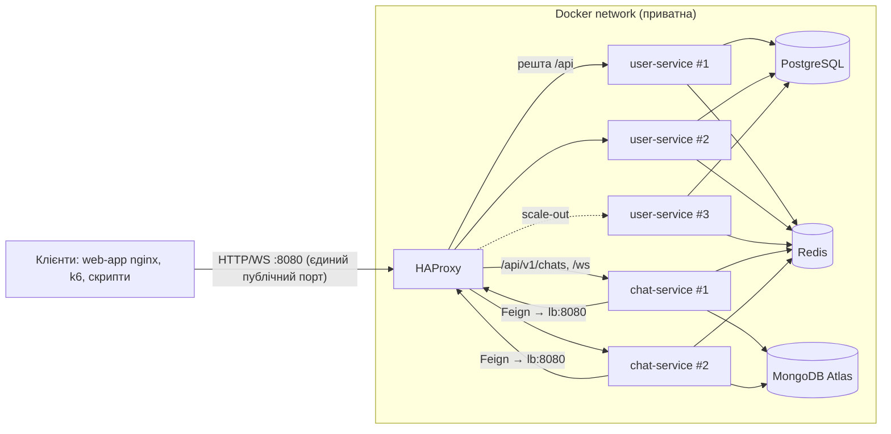

# Лабораторна №3 — Горизонтальне масштабування та балансування навантаження

**Обсяг:** `user-service` і `chat-service` за HAProxy. Stateless-підготовка — у [Lab 2](lab2-stateless.md).

## 2.1–2.2 Пул реплік і єдина точка входу



- Репліки: `deploy.replicas` у [docker-compose.yml](../src/docker-compose.yml), однаковий образ, власний
  `X-Instance-ID` (hostname контейнера), спільні PostgreSQL / MongoDB / Redis.
- **Інкапсуляція:** в основному [docker-compose.yml](../src/docker-compose.yml) у `user-service` і `chat-service`
  немає `ports`. Назовні відкриті тільки HAProxy `:8080` (і статистика `127.0.0.1:8404`). `web-app` (nginx) теж
  ходить у `lb:8080`; chat-service викликає user-service через той самий балансувальник.
  Для налагодження [docker-compose.override.yml](../src/docker-compose.override.yml) додає прямі порти реплік і Redis
  (Compose підхоплює його автоматично). Для демонстрації інкапсуляції запускайте лише основний файл:
  `docker compose -f docker-compose.yml up -d` — тоді `docker compose ps` не показує портів реплік, а запит
  на адресу репліки ззовні неможливий.
- [infra/haproxy.cfg](../src/infra/haproxy.cfg): `server-template ... resolvers docker` знаходить до 10 реплік
  кожного сервісу через Docker DNS — `docker compose up --scale user-service=3` не потребує зміни конфігу.
- Маршрутизація: `path_beg /api/v1/chats /ws` → `chat_service`, усе інше → `user_service`.
  `timeout tunnel 1h` тримає WebSocket-з'єднання.

## 2.3 Алгоритми балансування

Алгоритм задається змінною `LB_ALGORITHM` і перемикається без зміни коду, перестворенням лише контейнера `lb`:

```powershell
$env:LB_ALGORITHM = 'leastconn'      # roundrobin | leastconn | source
docker compose up -d --no-deps --force-recreate lb
```

| Алгоритм | Коли доречний | У цьому проєкті |
|---|---|---|
| `roundrobin` | Однорідні вузли, короткі запити схожої вартості | За замовчуванням для REST |
| `leastconn` | Запити різної тривалості, повільні вузли, довгі з'єднання | Найкращий для `/ws` (довгі WebSocket) і при деградації вузла |
| `source` (IP hash) | Потрібна прив'язка клієнта до вузла на рівні мережі | Не потрібен: stateless-сервіси, sticky лише ховає проблеми; за NAT / одним проксі всі клієнти потрапляють на один вузол |
| Weighted RR | Різна потужність вузлів | `server-template` дає однакові ваги; вагу можна змінити на льоту через runtime API (`set server user_service/user1 weight 50`) |

### Розподіл запитів (Round Robin)

```powershell
.\scripts\run-lab3.ps1 -Scenario distribution
```

30 послідовних `GET /api/v1/me`, 2 репліки (04.11.2026):

| X-Instance-ID | Запитів |
|---|---|
| `6c6284929ff8` | 15 |
| `447b66353f0c` | 15 |

### Асиметричне навантаження: Round Robin vs Least Connections

Профіль `lab3` вмикає [LabLatencyFilter](../src/web-api/common/src/main/java/com/bricklayers/common/instance/LabLatencyFilter.java):
запити з `X-Lab-Slow-Instance: <id>` на цій репліці затримуються на 500 мс (health checks і записи — ні).
Це повільний, але живий вузол — HAProxy його не виключає. Кеш вимкнено, щоб кожен запит доходив до БД.

```powershell
.\scripts\run-lab3.ps1 -Scenario algorithms   # 20 VU, 30 с, після 10 с прогріву
```

Фактичні результати (20 VU, 30 с, повільна репліка `f482abb5c3a0`):

| Алгоритм | RPS | avg, мс | p95, мс | p99, мс | Помилки | Розподіл (повільна / нормальна) |
|---|---|---|---|---|---|---|
| Round Robin | 77,8 | 254,1 | 506,2 | 509,0 | 0 | 1 191 / 1 191 |
| Least Connections | 5 260,8 | 3,6 | 2,8 | 4,7 | 0 | 600 / 159 601 |

**Висновок.** Round Robin віддає повільному вузлу рівно половину запитів незалежно від його стану. k6 працює в
замкненому циклі (20 VU чекають відповіді), тому кожен VU, що потрапив на повільний вузол, на 500 мс «виключається»
— весь пул опускається до швидкості найповільнішого вузла: ~78 RPS, p99 = затримка повільного вузла.
Least Connections бачить, що на повільному вузлі «висять» з'єднання, і спрямовує нові запити на вільний:
повільний вузол отримав 0,4 % запитів, пропускна здатність зросла у ~68 разів, p99 — 4,7 мс.
Для навантаження з різною тривалістю запитів (і для WebSocket) `leastconn` — правильний вибір;
`roundrobin` прийнятний лише для однорідних швидких вузлів.

## 2.4 Health Check та Fault Tolerance

- `GET /health` ([user-service](../src/web-api/user-service/src/main/java/com/bricklayers/userservice/controller/HealthController.java):
  `SELECT 1` у PostgreSQL; [chat-service](../src/web-api/chat-service/src/main/java/com/bricklayers/chatservice/controller/HealthController.java):
  `ping` MongoDB) → `200 UP` або `503 DOWN`. Redis не перевіряється: без нього сервіси працюють (Lab 4).
- **Активні перевірки:** `option httpchk GET /health`, кожну 1 с, `fall 2` / `rise 2`, timeout 2 с.
- **Пасивний захист:** `retry-on conn-failure` + `option redispatch` — якщо TCP-з'єднання з вузлом не
  встановилось, запит іде на інший вузол. Вже надісланий запит не повторюється (POST не дублюється).
- `server.shutdown: graceful` — при `docker stop` репліка дообробляє активні запити.
- Перевірка має відповідати швидко й тоді, коли залежність недоступна. Під час тестів MongoDB Atlas на кілька хвилин
  став недоступний, і `ping` висів 30 с (дефолтний server selection timeout драйвера): HAProxy перевіряє щосекунди,
  тож потоки Tomcat накопичувались. [MongoTimeoutConfig](../src/web-api/chat-service/src/main/java/com/bricklayers/chatservice/config/MongoTimeoutConfig.java)
  знижує таймаут до 5 с (`chat.mongo.server-selection-timeout`); HAProxy і так позначає вузол DOWN за 2 с.

```powershell
.\scripts\run-lab3.ps1 -Scenario failure      # k6 60 с, REQUIRE_NO_ERRORS; docker stop на 15-й с, start на 35-й
```

Фактичний прогін (20 VU, 60 с, `REQUIRE_NO_ERRORS=true`):

| Запитів | RPS | avg, мс | p95, мс | p99, мс | Помилки |
|---|---|---|---|---|---|
| 291 457 | 4 850,1 | 4,0 | 8,7 | 18,6 | **0** |

Журнал HAProxy під час прогону:

```
Server user_service/user1 is DOWN, reason: Layer4 connection problem, info: "Connection refused" ... 1 active ... left
Server user_service/user1 is UP, reason: Layer7 check passed, code: 200 ... 2 active ... online
```

Graceful `docker stop`: репліка перестає приймати з'єднання і дообробляє поточні запити, HAProxy за 1–2 с
виключає її з пулу, а `retry-on conn-failure` + `redispatch` перенаправляє спроби з'єднання на живий вузол —
клієнт не отримав жодної 5xx. Після `docker start` вузол повернувся в пул після двох успішних перевірок.

`docker kill` (SIGKILL) замість `stop` може обірвати запити, що саме виконувались на вузлі, і дає 1–2 с до
виключення вузла з пулу (2 невдалі перевірки) — це очікувана межа активних health checks.

## 2.5 Scale-out 1 → 2 → 3

```powershell
.\scripts\run-lab3.ps1 -Scenario scale        # round robin, без затримки, без кешу
```

Перший прогін без обмеження CPU (20 VU, 30 с) показав **падіння** RPS зі зростанням кількості реплік:

| Репліки | RPS | avg, мс | p99, мс |
|---|---|---|---|
| 1 | 7 314,4 | 2,6 | 7,2 |
| 2 | 5 639,8 | 3,4 | 14,6 |
| 3 | 4 187,2 | 4,6 | 25,2 |

Причина: усі контейнери ділять 20 ядер одного хоста, а 20 VU у замкненому циклі не насичують навіть одну репліку
(вона використовує кілька ядер). Вузьким місцем є генератор навантаження і накладні витрати хоста, а не бекенд,
тож нові JVM лише конкурують за ті самі ресурси (і кожна гірше прогріта JIT).

Щоб змоделювати окремі сервери, кожній репліці дано **1 CPU** (`USER_SERVICE_CPUS=1`), навантаження — 100 VU:

| Репліки | RPS | avg, мс | p95, мс | p99, мс | Помилки | Прискорення S(N) | Ефективність S(N)/N |
|---|---|---|---|---|---|---|---|
| 1 | 134,5 | 737,5 | 1 900,7 | 2 695,1 | 0,05 % (2 з 4 080) | 1,00 | 1,00 |
| 2 | 255,5 | 388,0 | 1 413,2 | 2 198,7 | 0,01 % (1 з 7 762) | 1,90 | 0,95 |
| 3 | 374,5 | 265,1 | 1 188,2 | 1 799,0 | 0 | 2,78 | 0,93 |

Тепер масштабування майже лінійне: CPU-bound бекенд (перевірка RSA-підпису JWT, серіалізація, Hibernate)
є вузьким місцем, і кожна репліка додає ~120 RPS. Поодинокі помилки на 1–2 репліках, імовірно, — перевантажений вузол
не встигав відповісти на health check за 2 с і на мить виключався з пулу (журнали HAProxy цього прогону не збереглися,
тому це гіпотеза).

### Наступні вузькі місця

| Компонент | Що спостерігали | Висновок |
|---|---|---|
| **PostgreSQL / пул з'єднань** | Без кешу ~2 транзакції на кожен `GET /api/v1/me` (386 921 commit за 30 с при 6,6 тис. RPS). Пул 10 × N реплік; при пулі 2 на репліку RPS падає до 1 748 | Наступне обмеження після CPU бекенду — одна спільна БД і `max_connections` (100 за замовчуванням: 10 реплік × 10 з'єднань уже на межі). Рішення: кеш ([Lab 4](lab4-distributed-caching.md) прибрав 99,99 % запитів), PgBouncer, read-репліки |
| **CPU бекенду** | При 1 CPU на репліку ~120–130 RPS, p99 у секундах | Валідація JWT і серіалізація — основна вартість запиту; масштабується горизонтально |
| **Міграції БД** | При першому старті 2 репліки одночасно запускають Liquibase на порожній БД, одна падає на `databasechangelog already exists` і стартує після автоперезапуску | Міграції краще виконувати окремим одноразовим job перед rollout |
| **HAProxy / хост** | Один процес, спільний хост із k6 | Не виміряно як обмеження в цих тестах; при реальному розгортанні — SPOF (див. нижче) |
| **Keycloak** | JWKS кешується у сервісах, на кожен запит не викликається | Не вузьке місце для читання; логін/видача токенів — окреме навантаження |

## Single Point of Failure

Після масштабування бекенду єдиною точкою відмови став сам HAProxy (а також PostgreSQL і Redis).
Варіанти усунення:
- **2× HAProxy + Keepalived (VRRP):** віртуальна IP-адреса належить активному балансувальнику; при його
  відмові резервний забирає VIP за ~1–3 с.
- **DNS Round Robin** кількох балансувальників — простий, але відмова відпрацьовує повільно через кешування
  DNS на клієнтах (TTL), тому годиться лише як доповнення.
- Керовані хмарні балансувальники (AWS ALB/NLB, GCP LB), у Kubernetes — Ingress-контролер з кількома репліками.

## Відтворення

```powershell
cd src
docker compose up -d --build --wait
.\scripts\run-lab3.ps1 -Scenario all
Get-ChildItem results\*.json        # повні метрики k6 кожного прогону
```

`run-lab3.ps1` після експериментів повертає 2 репліки, `roundrobin`, увімкнений кеш і профіль `default`.
