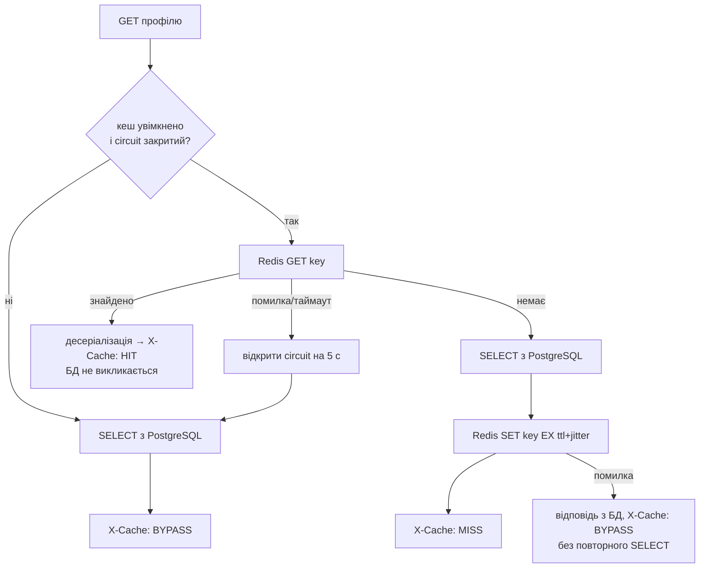

# Лабораторна №4 — Розподілене кешування

**Обсяг:** Cache-Aside профілів користувачів у `user-service`; спільний Redis для всіх реплік.
Redis також несе pub/sub подій чату ([Lab 2](lab2-stateless.md)), але це окрема функція, не кеш.

## 2.1 Що кешуємо і чому

Профіль користувача читається **на кожен автентифікований запит** у системі:

| Хто читає | Навіщо | Частота |
|---|---|---|
| `CurrentUserIdArgumentResolver` (user-service) | JWT `sub` → локальний `userId` для `/api/v1/me`, `/api/v1/users` | кожен запит до цих ендпоінтів |
| `ChatIdentityService` (chat-service → `GET /api/v1/me/by-keycloak-id/{id}`) | компанія, ім'я, активність користувача для перевірки доступу до чату | **кожен** REST-запит і кожен STOMP `CONNECT` чату |
| `GET /api/v1/admin/users/{id}`, `GET /api/v1/me` | відображення профілю | за діями користувача |

| Критерій | Оцінка |
|---|---|
| Читання vs запис | Сотні читань на одну зміну: профіль змінюють адмін (PUT/DELETE) і синхронізація з Keycloak (лише при реальних змінах) |
| Допустима застарілість | Секунди: після зміни кеш скидається явно; TTL — лише страховка |
| Вартість запиту | Окремо дешевий SELECT за індексом, але він множиться на всі запити чату й займає з'єднання пулу Hikari — зі зростанням реплік це головне вузьке місце (див. Lab 3) |

Не кешуються: списки (`/api/v1/admin/users`, колеги) — рідкісні запити зі складною інвалідацією; записи й
перевірки прав — завжди транзакційно в PostgreSQL.

## 2.2 Інтеграція Redis

`redis:7.4-alpine` у [docker-compose.yml](../src/docker-compose.yml): без persistence, `maxmemory 128mb`,
`allkeys-lru`, порт не публікується. Усі репліки використовують один Redis (`REDIS_HOST=redis`).
Таймаути з'єднання та команд — 200 мс.

## 2.3 Cache-Aside

[UserProfileCache.java](../src/web-api/user-service/src/main/java/com/bricklayers/userservice/cache/UserProfileCache.java):



Помилки БД (наприклад, користувача не знайдено) прокидаються як є і не кешуються.

## 2.4 Ключі та TTL

| Ключ | Значення |
|---|---|
| `user:profile:v1:id:{uuid}` | JSON `UserDto` за локальним id |
| `user:profile:v1:kc:{keycloakId}` | той самий JSON за Keycloak `sub` |

- `user:profile` — домен і сутність, `v1` — версія формату (зміна `UserDto` → `v2`, старі ключі просто
  вичерпають TTL), далі тип ідентифікатора і сам ідентифікатор. Інших параметрів у запитів немає, тож
  `params_hash` не потрібен; колізій між `id:` і `kc:` немає.
- **TTL = 300 с + випадкові 0–10 %** (`CACHE_TTL_SECONDS`). Свіжість гарантує інвалідація, тому TTL обрано
  як баланс між hit rate і межею застарілості при збоях інвалідації; jitter не дає ключам, закешованим одночасно
  (наприклад, після рестарту Redis), протухнути одночасно (cache avalanche).

## 2.5 Інвалідація

`evict(id, keycloakId)` видаляє обидва ключі:

| Операція | Де |
|---|---|
| `PUT /api/v1/admin/users/{id}` | `UserServiceImpl.update` |
| `DELETE /api/v1/admin/users/{id}` (і `deleteAll`) | `UserServiceImpl.delete` |
| Зміна профілю в Keycloak | `KeycloakUserImportService` — лише для користувачів, що реально змінились (раніше синхронізація перезаписувала всіх щохвилини) |

- Усередині транзакції видалення реєструється як `afterCommit`: відкат — без інвалідації; паралельний читач
  не закешує незакомічені дані.
- Інвалідація виконується в тілі методу, а не через AOP-проксі, тож працює і при self-invocation (`deleteAll → delete`).
- Між commit у PostgreSQL і `DEL` у Redis немає спільної транзакції. Якщо `DEL` не вдався (Redis недоступний),
  це логується, запис не відкочується, а застарілість обмежена TTL. Після рестарту Redis без persistence кеш
  порожній — застарілих даних немає.

## 2.6 Демонстрація та виміри

```powershell
.\scripts\demo-cache.ps1                    # MISS → HIT ×5 → PUT → MISS → HIT
.\scripts\demo-cache.ps1 -SimulateFailure   # + docker compose stop redis → BYPASS, запис працює → start
```

Фактичний прогін (04.11.2026, 2 репліки, `GET /api/v1/admin/users/{id}` профілю `worker`):

| Крок | Репліка | X-Cache | Час, мс |
|---|---|---|---|
| PUT (інвалідація) | `efea6247c795` | — | 86 |
| GET | `69f46e631664` | MISS | 18,9 |
| GET ×5 | обидві по черзі | HIT | 13,6–17,2 |
| PUT (відновлення імені) → GET | `efea6247c795` | MISS (свіжі дані) | 16,9 |
| `docker compose stop redis` → GET | `efea6247c795` | BYPASS (перший запит чекає таймаут, circuit відкривається) | 220,6 |
| PUT при вимкненому Redis | `69f46e631664` | — | 263 (200 мс — спроба `DEL`) |
| GET | `efea6247c795` | BYPASS (circuit відкритий, Redis не викликається) | 17,4 |
| `start redis`, 6 с → GET, GET | обидві | MISS → HIT | 85 → 54 |

HIT на іншій репліці, ніж MISS, підтверджує, що кеш спільний. Одиничні заміри з PowerShell містять ~13 мс
клієнтських накладних витрат (HTTP, JSON у PowerShell), тому різниця HIT/MISS тут мала — дивіться виміри під навантаженням.

### Під навантаженням (k6, 2 репліки, 20 VU, 30 с, `GET /api/v1/me`)

**A. Звичайна конфігурація** (пул 10 з'єднань на репліку, без обмеження CPU, 20 VU):

| Кеш | RPS | avg, мс | p95, мс | p99, мс | Запитів | Транзакцій PostgreSQL | Транзакцій на запит |
|---|---|---|---|---|---|---|---|
| вимкнено | 6 591,5 | 2,88 | 5,92 | 12,09 | 198 349 | 386 921 | 1,95 |
| увімкнено | 3 638,4 | 5,22 | 13,56 | 24,63 | 114 043 | 19 | 0,0002 |

Кеш прибрав **99,99 %** звернень до БД, але латентність тут зросла. Усе працює на одному хості: SELECT за
первинним ключем у «гарячій» локальній PostgreSQL коштує стільки ж, скільки мережевий round-trip до Redis
(виміряно `redis-cli --latency` між контейнерами: avg 0,77 мс, max 8 мс), а `/api/v1/me` робить два звернення
до кешу (резолвер `@CurrentUserId` і `getById`). Для дешевого запиту і ненавантаженої БД кеш не прискорює —
це очікуваний і важливий висновок.

**B. БД — вузьке місце** (пул 2 з'єднання на репліку, як буває, коли багато реплік ділять `max_connections`; 100 VU):

| Кеш | RPS | avg, мс | p95, мс | p99, мс | Запитів | Транзакцій PostgreSQL |
|---|---|---|---|---|---|---|
| вимкнено | 1 748,4 | 56,54 | 195,63 | 346,34 | 52 842 | 104 779 |
| увімкнено | 5 059,6 | 19,43 | 60,83 | 122,04 | 152 624 | 88 |

Коли спільна БД стає обмеженням (а з Lab 3 це наступне вузьке місце після масштабування бекенду), кеш дає
**×2,9 RPS і втричі нижчий p99**: запити більше не стоять у черзі за з'єднанням пулу.

## Fallback (Graceful Degradation)

- Redis не входить у `/health` і `depends_on` бекенду: зупинка Redis не виключає репліки з балансувальника.
- Читання → `BYPASS` з PostgreSQL; запис працює; інвалідація логується як невдала.
- **Circuit breaker:** після першої помилки Redis читання 5 с не звертаються до Redis взагалі — інакше кожен
  запит чекав би 200 мс таймауту з'єднання. Виміряно: перший BYPASS 220,6 мс, наступний — 17,4 мс.
  Інвалідація при відкритому circuit усе одно виконується — пропускати її небезпечно для узгодженості.
- chat-service без Redis теж стартує: підписка на канал подій повторюється у фоні.

## Теоретичні питання

- **Expiration vs Invalidation.** Expiration — запис зникає сам після TTL (обмежує застарілість «у середньому»).
  Invalidation — примусове видалення при зміні даних (дає свіжість одразу після запису). Тут основна —
  інвалідація, TTL — страховка.
- **Cache Stampede / Thundering Herd.** Популярний ключ зникає — багато паралельних MISS одночасно б'ють у БД.
  Тут ризик малий (ключ на користувача, інвалідація точкова); захист за потреби — single-flight /
  розподілений lock на заповнення (`SET NX`), «ранній» перерахунок до TTL.
- **Cache Avalanche.** Масове одночасне закінчення TTL або падіння Redis. Захист: jitter TTL (зроблено),
  circuit breaker + обмеження навантаження на БД при fallback (зроблено частково — fallback усе одно
  переносить усі читання на PostgreSQL).
- **Eviction.** LRU — витіснення ключів, до яких найдовше не зверталися (`allkeys-lru`, обрано: «гарячі»
  профілі активних користувачів лишаються); LFU — найрідше використовуваних (краще для стабільно популярних
  ключів, гірше реагує на зміну популярності).
