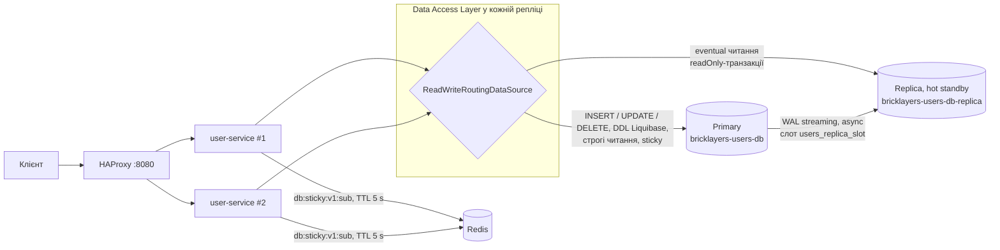

# Лабораторна №6 — Реплікація БД і Read/Write Separation

**Обсяг:** база `users_db` сервісу `user-service` (PostgreSQL 16). `chat-service` працює з MongoDB Atlas, а
там replica set уже надає хмарний провайдер. Тому реплікацію в цій лабі зроблено для PostgreSQL.

## 1. Топологія



| Вузол | Контейнер | Порт на хості | Роль |
|---|---|---|---|
| Primary | `bricklayers-users-db` | 5433 | приймає всі мутації; `wal_level=replica`, `max_wal_senders=10`, `max_replication_slots=10`, `wal_keep_size=256MB` |
| Replica | `bricklayers-users-db-replica` | 5436 | `hot_standby=on`, лише читання; відтворює WAL Primary через фізичний слот `users_replica_slot` |
| Replica 2 (лише для експерименту §6) | `bricklayers-users-db-replica-2` | — | профіль Compose `replica2`; без слота (WAL утримує `wal_keep_size`), щоб невикористаний слот не накопичував WAL |

Конфігурація — [docker-compose.yml](../src/docker-compose.yml) і [src/infra/postgres](../src/infra/postgres):
- [primary-pg_hba.conf](../src/infra/postgres/primary-pg_hba.conf) дозволяє підключення для реплікації ролі
  `replicator` (`host replication replicator all scram-sha-256`). Файл підключено через `hba_file`, тож він
  діє і на вже наявному томі `users_db_data`.
- Одноразовий контейнер `users-db-replication-setup` виконує
  [replication-setup.sql](../src/infra/postgres/replication-setup.sql): створює роль
  `replicator WITH REPLICATION` і фізичний слот `users_replica_slot`. Обидві операції ідемпотентні.
- [replica-entrypoint.sh](../src/infra/postgres/replica-entrypoint.sh): на порожньому томі робить
  `pg_basebackup -X stream -R -S users_replica_slot`. Ключ `-R` створює `standby.signal` і `primary_conninfo`.
  Далі вузол запускається як hot standby. Змінна `REPLICA_APPLY_DELAY` задає `recovery_min_apply_delay`
  і так штучно відтворює затримку реплікації.

Реплікація **асинхронна** (`sync_state = async`): commit на Primary не чекає Replica. Синхронний режим
(`synchronous_standby_names`) дав би сильну консистентність ціною затримки кожного запису.

## 2. Read/Write Separation у коді

Маршрутизацію реалізовано програмно, у шарі доступу до даних
([db/](../src/web-api/user-service/src/main/java/com/bricklayers/userservice/db)):

```
JPA / JdbcTemplate
  └─ LazyConnectionDataSourceProxy        бере фізичне з'єднання лише на першому SQL, коли транзакція вже відкрита
       └─ ReadWriteRoutingDataSource       AbstractRoutingDataSource: вибір пулу для кожного з'єднання
            ├─ HikariCP "primary"
            └─ ReplicaPool                 HikariCP "replica-1", "replica-2", ... (DB_REPLICA_URL через кому):
                                           readOnly, connectionTimeout 1 s, старт без доступної Replica,
                                           round-robin між доступними
```

[ReadWriteRoutingDataSource.decide()](../src/web-api/user-service/src/main/java/com/bricklayers/userservice/db/ReadWriteRoutingDataSource.java)
вибирає вузол за таким правилом:

| Умова | Маршрут (`X-DB-Route`) |
|---|---|
| Транзакція не readOnly (будь-який запис, Liquibase, ShedLock) | `primary` |
| Replica вимкнена (`DB_REPLICA_ENABLED=false`) | `primary-single` |
| `@ReadFromPrimary` / `ReadRoutingContext.onPrimary(...)` | `primary-explicit` |
| Користувач писав протягом останніх `READ_YOUR_WRITES_TTL` | `primary-sticky` |
| Жодна Replica не доступна (позначена `ReplicaHealth` або не дала з'єднання) | `primary-fallback` |
| Інакше: `@Transactional(readOnly = true)` | `replica-1`, `replica-2`, … (по колу) |

Маршрут кожного з'єднання повертається в заголовку відповіді `X-DB-Route`, тож рішення видно в Swagger, k6 і демо-скрипті.

## 3. Класифікація читань

| Операція | Консистентність | Вузол | Чому |
|---|---|---|---|
| `GET /api/v1/users`, `/api/v1/users/{id}` (довідник колег) | eventual | Replica | публічний список, мілісекунди застарілості не шкодять |
| `GET /api/v1/admin/users` (сторінка адмінки) | eventual | Replica (sticky для автора змін) | перегляд списку |
| `GET /api/v1/admin/audit`, аудит в огляді акаунта | eventual | Replica | звіт/аналітика |
| `GET /api/v1/admin/users/stats` | eventual | Replica | агрегат |
| Автентифікація: `sub` з JWT → локальний профіль (`CurrentUserIdArgumentResolver`) | strict | Primary (`onPrimary`) | рішення про доступ не можна приймати на застарілих даних |
| `getById` / `getByKeycloakId` (`/api/v1/me`, профіль для chat-service) | strict | Primary (`@ReadFromPrimary`) | ці читання наповнюють кеш профілів (Lab 4). Читання з Replica після інвалідації поклало б у Redis **старе** значення на весь TTL |
| `PUT` / `POST` / `DELETE`, синхронізація з Keycloak, аудит | — | Primary | мутації |

## 4. Read-After-Write Consistency

Обрано два механізми.

1. **Session Sticky Routing.** Після commit записувальної транзакції автентифікованого користувача
   [ReadYourWritesTracker](../src/web-api/user-service/src/main/java/com/bricklayers/userservice/db/ReadYourWritesTracker.java)
   записує в Redis ключ `db:sticky:v1:{sub}` з TTL `READ_YOUR_WRITES_TTL` (5 с), який має бути більшим за очікувану затримку.
   [ReadYourWritesInterceptor](../src/web-api/user-service/src/main/java/com/bricklayers/userservice/db/ReadYourWritesInterceptor.java)
   на початку кожного запиту перевіряє цей ключ, і тоді всі читання користувача йдуть на Primary.
   Стан тримається в Redis, а не в пам'яті, тому працює незалежно від того, на яку репліку user-service
   балансувальник направить наступний запит (див. Lab 2). Якщо Redis недоступний, circuit breaker на 5 с
   відправляє читання на Primary: консистентність важливіша за розвантаження.
2. **Explicit Primary Routing** для критичних об'єктів: `@ReadFromPrimary` і `ReadRoutingContext.onPrimary`, див. §3.

Коли Replica вимкнена, трекер вимкнений теж і не робить жодного запиту в Redis. Тож базовий замір
Lab 5 не платить за механізм, який там не потрібен.

## 5. Відмовостійкість

| Збій | Поведінка |
|---|---|
| `docker stop bricklayers-users-db-replica` | Перше з'єднання до Replica падає за ≤ 1 с (connectionTimeout), запит **того ж** виклику переходить на Primary (`primary-fallback`), `ReplicaHealth` позначає Replica недоступною; фонова перевірка кожні 2 с повертає її після відновлення. `/health` = `DEGRADED` (200), HAProxy не виводить репліки user-service з ротації |
| `docker stop bricklayers-users-db` | Мутації отримують `503` + `Retry-After` з повідомленням «Сервіс у режимі лише читання» (`GlobalExceptionHandler.handleDatabaseUnavailable`), а не 500. Eventual-читання з Replica працюють. Строгі читання також отримують 503 — свідомо, бо на Replica вони можуть бути застарілими. `/health` = `READ_ONLY` (200), щоб балансувальник продовжував слати читання |

`/health` раніше відповідав 503 при будь-якій проблемі з БД. З падінням Primary це прибрало б із HAProxy
усі репліки user-service і зламало б режим «лише читання», тому `/health` тепер враховує обидва вузли.

## 6. Демонстрація

```powershell
cd src
docker compose up -d --build --wait
.\scripts\demo-replication.ps1
```

[demo-replication.ps1](../src/scripts/demo-replication.ps1) створює двох тимчасових користувачів: «ціль» і
«читача» з тієї ж компанії, з паролем. Наприкінці скрипт їх видаляє. Затримку Replica він повертає до 0,
а зупинені вузли запускає знову. Повний вивід прогону лежить у
[results/lab6/demo-replication.log](../src/results/lab6/demo-replication.log):

```
== 1. Topology (GET /api/v1/admin/db/replication)
  primary : wal sender to 172.18.0.14/32 state=streaming sync=async sent=0/6292618 replay=0/6292618 lag=0 B
  replica : in_recovery=True replay_lsn=0/6292618
== 2. Write on the primary, read the row on the replica
  replica: SELECT last_name FROM users WHERE username = 'repl-target-223626' -> 'Initial'
== 3. Replication lag: replica applies WAL 3s late
  replica restarted with recovery_min_apply_delay = 3s
  PUT  /api/v1/admin/users/{id}          -> 200  X-DB-Route=replica-1,primary   admin writes lastName=Lag223626
  GET  /api/v1/users                     -> 200  X-DB-Route=replica-1           another user (eventual read): lastName=Initial
  ok  STALE READ: the replica still returns the old value
  GET  /api/v1/admin/users?page=0&size=100 -> 200 X-DB-Route=primary-sticky     the writer (sticky): lastName=Lag223626
  ok  READ-YOUR-WRITES: the writer is routed to the primary and sees the change
  replication status right after the write: lag_bytes=26768
  GET  /api/v1/users                     -> 200  X-DB-Route=replica-1           after the delay: lastName=Lag223626
== 4. docker stop bricklayers-users-db-replica : reads fall back to the primary
  GET  /api/v1/users                     -> 200  X-DB-Route=primary-fallback  1259 ms
  /health: {"primary":"UP","replica-1":"DOWN","status":"DEGRADED"}
  PUT  /api/v1/admin/users/{id}          -> 200  writes are unaffected
  GET  /api/v1/users                     -> 200  X-DB-Route=replica-1           replica is back
== 5. docker stop bricklayers-users-db : read-only mode
  /health: {"primary":"DOWN","replica-1":"UP","status":"READ_ONLY"}
  PUT  /api/v1/admin/users/{id}          -> 503  1248 ms  Сервіс у режимі лише читання: зміни тимчасово недоступні, повторіть пізніше
  GET  /api/v1/users                     -> 200  X-DB-Route=replica-1           non-critical read from the replica
  GET  /api/v1/admin/users/{id}          -> 503  X-DB-Route=primary-explicit  56 ms  strict read (@ReadFromPrimary)
```

`X-DB-Route=replica-1,primary` у PUT показує два з'єднання в одному запиті: аспект `@RequireKeycloakLink`
спершу читає цільового користувача в окремій readOnly-транзакції репозиторію, а потім іде сама транзакція
запису. 1259 мс першого запиту після зупинки Replica — це `connectionTimeout` пулу Replica (1 с), після якого
той самий запит перейшов на Primary. Наступні запити Primary Fallback обслуговує одразу, бо Replica вже
позначена недоступною.

**Дефект, знайдений на кроці 5.** Перша версія `/health` брала з'єднання з пулу Primary і при зупиненому Primary
чекала весь `connectionTimeout` (3 с). Тайм-аут перевірки HAProxy — 2 с, тож балансувальник виводив з ротації
**всі** репліки user-service, і eventual-читання отримували 503 від HAProxy. Запис чекав 6,3 с: дві спроби взяти
з'єднання по 3 с. Виправлення:
[NodeHealth](../src/web-api/user-service/src/main/java/com/bricklayers/userservice/db/NodeHealth.java)
перевіряє кожен вузол раз на 2 с **окремим** коротким підключенням (`connectTimeout=1`, `socketTimeout=2`), а не
через пул, тож вичерпаний під навантаженням пул не робить вузол «недоступним». `/health` віддає вже відомий
стан миттєво, а маршрутизатор, поки Primary позначений недоступним, одразу відмовляє в записі: 503 за 1,2 с
замість 6,3 с, строге читання — за 56 мс. Вузол позначається недоступним і під час запиту, але лише коли
не вдалося саме підключення до БД (є причина-виняток), а не коли пул вичерпано.

## 7. Теоретичні питання

- **Синхронна / асинхронна / напівсинхронна реплікація.**
  - Синхронна (`synchronous_commit=on` + `synchronous_standby_names`): commit чекає підтвердження від Replica.
    Втрати даних немає, але кожен запис платить RTT до Replica, а якщо Replica недоступна, записи блокуються.
  - Асинхронна (тут): commit одразу, Replica відстає на lag. При аварії Primary можна втратити останні
    транзакції, а читання з Replica можуть бути застарілими.
  - Напівсинхронна (MySQL semi-sync; у PostgreSQL — `ANY 1 (...)` / `remote_write`): чекаємо, поки хоча б одна
    Replica *отримала* WAL, але не відтворила його.
- **Split-Brain.** Два вузли одночасно вважають себе Primary і приймають записи. Історії розходяться, і злити їх
  без втрат не вийде. Захист: кворум, fencing/STONITH, лідерство за консенсусом.
- **CAP.** Під час мережевого розділення (P) система вибирає між C і A. Наш режим «лише читання» при падінні
  Primary — це вибір C для записів (відмова замість розходження) і A для eventual-читань.
- **PACELC.** Навіть без розділення (E) є компроміс Latency ↔ Consistency. Асинхронна реплікація та читання з
  Replica дають меншу затримку ціною eventual-консистентності, а sticky routing повертає C там, де вона потрібна.
- **Вибір нового лідера.** Тут failover ручний (у вимогах лаби його немає). Автоматичний робиться через
  консенсус: Patroni (etcd/Consul/ZooKeeper на Raft/ZAB), Raft-підхід у CockroachDB, Sentinel у Redis. Лідер
  обирається більшістю голосів за термами, і після обрання нового лідера старий Primary має бути відсічений (fencing).
